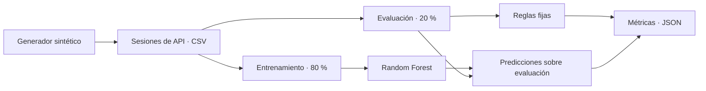

<div align="center">

# 🛡️ NeuroSentinel

### Laboratorio de detección de comportamiento en APIs

Investigación reproducible con telemetría sintética, reglas y aprendizaje automático.


[Descripción](#-descripción) · [Inicio rápido](#-inicio-rápido) · [Resultados](#-resultados-de-referencia) · [Metodología](#-metodología)

</div>

---

> [!IMPORTANT]
> **Prototipo de investigación con datos sintéticos.** Los resultados no demuestran detección de ataques reales, atribución a inteligencia artificial ni aptitud para producción. El laboratorio no realiza solicitudes de red, escaneos ni explotación de sistemas externos.

## 🔎 Descripción

NeuroSentinel explora si las características de una sesión de API permiten distinguir actividad legítima de automatización maliciosa simulada. Incluye un generador local, un detector por reglas y un modelo supervisado opcional para establecer una base reproducible antes de evaluar datos externos autorizados.

| Componente | Función |
| :--- | :--- |
| **Generador sintético** | Crea tres escenarios con semilla configurable y comportamientos parcialmente solapados. |
| **Detector por reglas** | Evalúa frecuencia de solicitudes, errores e intentos sobre rutas sensibles. |
| **Random Forest** | Aprende a clasificar sesiones mediante nueve características de comportamiento. |
| **Evaluación** | Exporta sesiones en CSV y métricas en JSON. |
| **Protocolo** | Documenta controles, riesgos de fuga de información y límites del experimento. |

## 🔄 Flujo del experimento



## 🚀 Inicio rápido

### 1. Preparar el entorno

Requiere **Python 3.10 o superior**. Ejecuta los comandos desde la raíz del repositorio.

```bash
python -m venv .venv
```

| Sistema | Activar el entorno |
| :--- | :--- |
| Windows · PowerShell | `.\.venv\Scripts\Activate.ps1` |
| Linux / macOS | `source .venv/bin/activate` |

### 2. Ejecutar el laboratorio A0

El generador y el detector por reglas utilizan únicamente la biblioteca estándar de Python.

```bash
python src/lab.py --seed 42 --per-group 180
```

Esta configuración genera **540 sesiones**: 432 para entrenamiento y 108 para evaluación.

| Archivo generado | Contenido |
| :--- | :--- |
| `data/synthetic_sessions.csv` | Sesiones, características, etiquetas y partición asignada. |
| `results/baseline.json` | Configuración y métricas del detector por reglas. |

### 3. Ejecutar las pruebas

```bash
python -m unittest discover -s tests -v
```

Las pruebas comprueban reproducibilidad, partición de datos, métricas y entropía.

### 4. Probar Random Forest · opcional

Instala las dependencias y ejecuta el modelo **después de generar el CSV**:

```bash
python -m pip install -r requirements.txt
python src/ml_baseline.py
```

El modelo utiliza 150 árboles, `random_state=42` y pesos de clase balanceados. Guarda precisión, recall, F1, average precision —registrada como `pr_auc`— y matriz de confusión en `results/ml_baseline.json`.

<details>
<summary><strong>⚙️ Parámetros del laboratorio</strong></summary>

| Parámetro | Valor predeterminado | Descripción |
| :--- | :--- | :--- |
| `--seed` | `42` | Semilla del generador. |
| `--per-group` | `180` | Sesiones por escenario. |
| `--output` | `data/synthetic_sessions.csv` | Ruta del CSV de salida. |
| `--results` | `results/baseline.json` | Ruta del informe JSON. |

```bash
python src/lab.py --seed 7 --per-group 300 --output data/experiment_7.csv --results results/experiment_7.json
```

El script de ML lee siempre `data/synthetic_sessions.csv`; no utiliza automáticamente la ruta alternativa del ejemplo.

</details>

## 📊 Resultados de referencia

Resultados del detector por reglas incluidos en [`results/baseline.json`](results/baseline.json), con semilla `42` y 180 sesiones por escenario:

| Métrica | Valor |
| :--- | ---: |
| Precisión · precision | **100 %** |
| Sensibilidad · recall | **87,5 %** |
| F1 | **0,9333** |
| Tasa de falsos positivos | **0 %** |
| Sesiones de evaluación | **108** |

**Matriz de confusión**

| Etiqueta real ↓ / Predicción → | Legítima | Maliciosa |
| :--- | ---: | ---: |
| Legítima | 36 | 0 |
| Maliciosa | 9 | 63 |

> [!WARNING]
> Estas métricas describen únicamente la muestra sintética de referencia. Las distribuciones diseñadas por el generador pueden facilitar la clasificación; un buen resultado no demuestra generalización a tráfico real.

## 🧪 Metodología

### Escenarios simulados

| Escenario | Descripción | Etiqueta binaria |
| :--- | :--- | :---: |
| `legitimate` | Sesiones legítimas simuladas. | `0` |
| `scripted_probe` | Automatización convencional simulada. | `1` |
| `adaptive_probe` | Automatización adaptativa simulada; no ejecuta un agente de IA. | `1` |

### Características y reglas

El Random Forest utiliza nueve variables: `requests`, `duration_s`, `rps`, `error_rate`, `unique_paths`, `path_entropy`, `mean_interval`, `interval_cv` y `sensitive_attempts`.

Los campos `scenario`, `session`, `split`, `automation_type` y `label_malicious` **no se utilizan como características**. `automation_type` es una etiqueta del generador, no una inferencia del detector.

El detector por reglas clasifica una sesión como maliciosa si cumple al menos una condición:

- Más de **1,15 solicitudes por segundo**.
- Tasa de errores superior al **30 %**.
- **3 o más** intentos sobre rutas sensibles.

### Evaluación y límites

- Cada quinta sesión de cada escenario se reserva para evaluación: proporción 80/20 en la configuración predeterminada, con identificadores de sesión distintos entre particiones.
- El modelo supervisado se ajusta únicamente con las sesiones de entrenamiento.
- Los umbrales actuales son ilustrativos; deben fijarse antes de una evaluación confirmatoria y no ajustarse usando el conjunto de evaluación.
- No se evalúan atribución a LLMs, ataques reales ni despliegue en producción.
- Quedan pendientes validación externa, particiones temporales, intervalos de confianza, calibración y estudios de ablación.

Consulta el [protocolo del experimento A0](docs/experiment_A0.md) para conocer el diseño completo.

## 📁 Estructura del proyecto

```text
neurosentinel/
├── data/
│   └── synthetic_sessions.csv   # Sesiones sintéticas
├── docs/
│   └── experiment_A0.md        # Protocolo de investigación
├── results/
│   ├── baseline.json           # Resultados del detector por reglas
│   └── ml_baseline.json        # Generado al ejecutar el modelo opcional
├── src/
│   ├── lab.py                  # Generación, reglas y métricas
│   └── ml_baseline.py          # Entrenamiento y evaluación de Random Forest
├── tests/
│   └── test_lab.py             # Pruebas unitarias
├── requirements.txt           # Dependencia opcional de ML
└── README.md
```

## 🗺️ Próximos pasos

- [ ] Definir criterios de inclusión y exclusión para la revisión bibliográfica.
- [ ] Seleccionar datasets externos con procedencia y licencias verificadas.
- [ ] Crear un recolector de telemetría de API en un entorno autorizado, eliminando datos sensibles.
- [ ] Prerregistrar hipótesis, protocolo de evaluación y política de partición antes de ajustar modelos.
- [ ] Ampliar la evaluación con semillas no utilizadas y un conjunto confirmatorio intacto.
- [ ] Desarrollar el experimento B: simulación local de RAG y herramientas, políticas defensivas y medición de la tasa de éxito de ataques.

## 🤝 Contribuciones

Las propuestas deben describir el problema, el cambio y cómo reproducir su evaluación. Para cambios en el generador o los detectores, documenta el efecto sobre las métricas y evita ajustar parámetros contra el conjunto de evaluación. Ejecuta las pruebas antes de presentar una contribución.

## 📄 Licencia

El repositorio no incluye actualmente un archivo de licencia. Antes de reutilizar o distribuir el código, consulta las condiciones con sus responsables.
